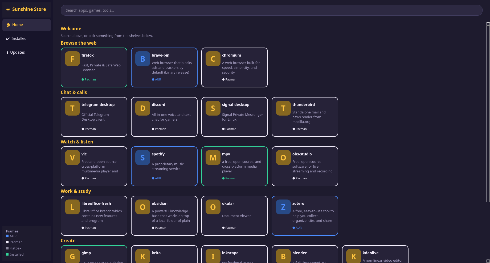
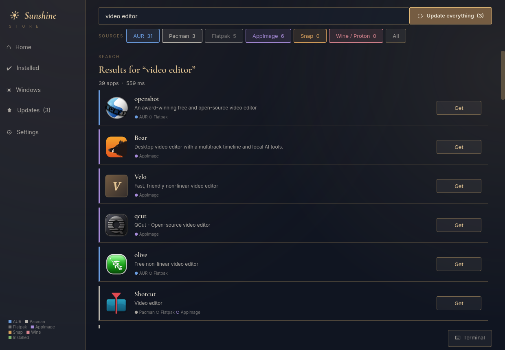
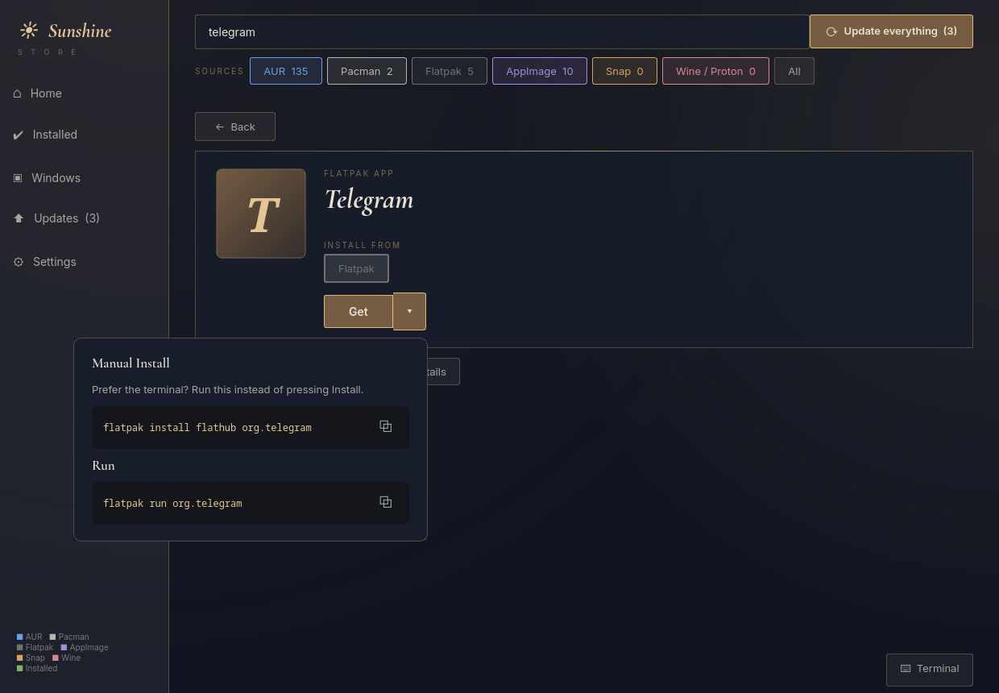
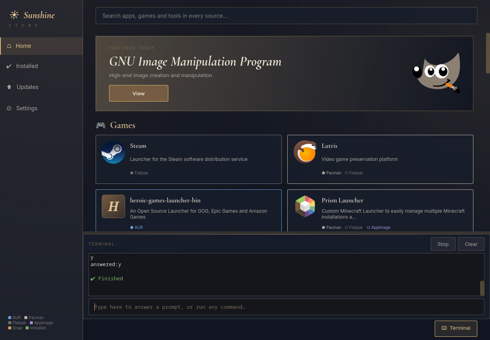
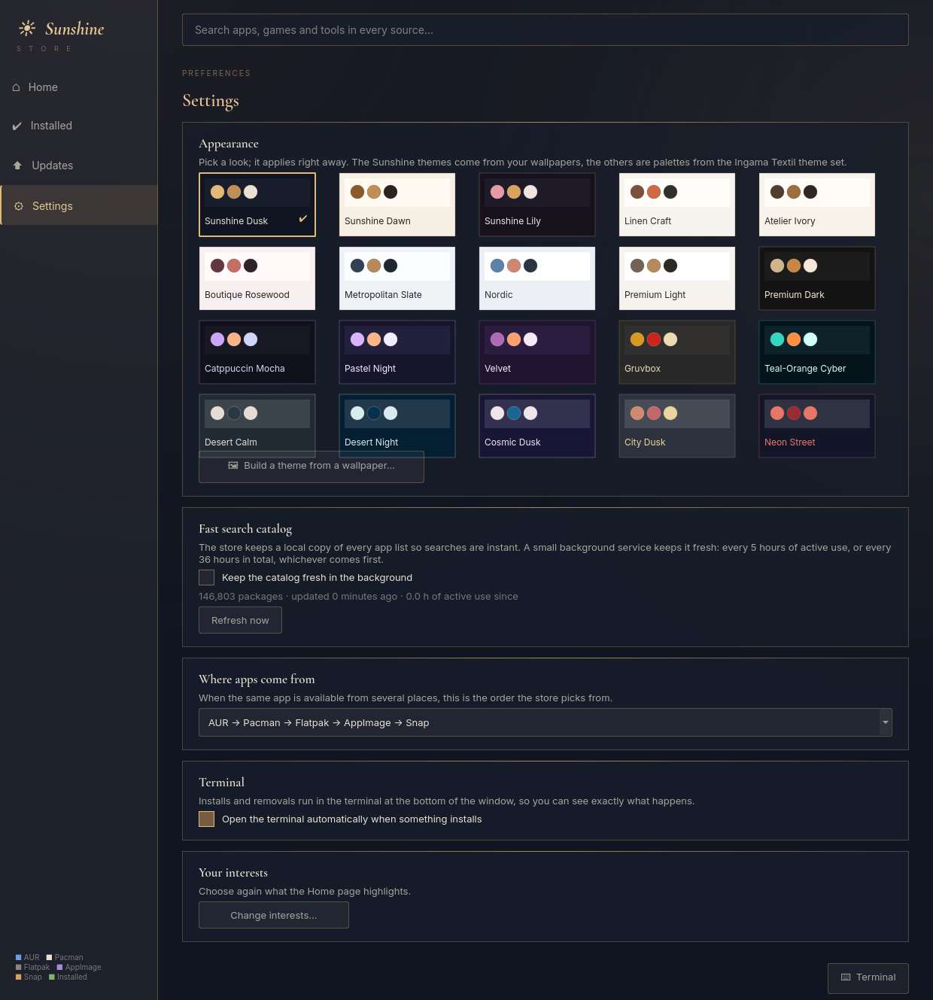
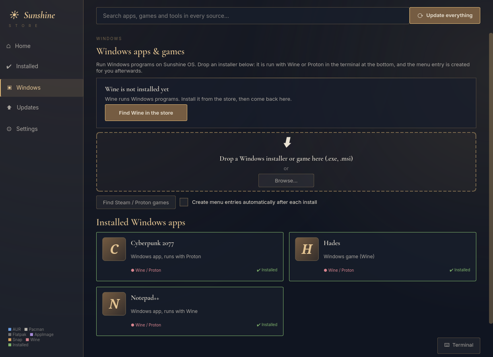

# Sunshine Store

An app store for Arch Linux in the style of the Microsoft Store and GNOME Software. One search covers **pacman**,
the **AUR**, **Flatpak**, **AppImage** and **Snap**, and the same app from several places is shown as one card.
Built for [Sunshine OS](https://github.com/tak0dan); works on any Arch system.

## Highlights
- **Instant, always-available catalogue.** A persistent local catalogue (every repo package, the whole AUR, Flathub, AppImage and
  Arch's AppStream data) is what the store reads. Opening it never waits for a repository: the last published catalogue is
  on screen at once and searched in a few milliseconds (SQLite full-text index), even offline. A refresh runs in the
  background and **keeps serving the old catalogue until a complete new generation is ready**.
- **Software identities and related software.** Discord from pacman, the AUR (`-bin`, `-git`, `-canary`...) and Flathub is
  *one* app. Search "discord" and you also get what is built around it, grouped: **clients & front-ends**, **plugins &
  integrations**, **forks & derivatives**, each with the evidence behind it. A client is never mistaken for a distribution of the
  app it connects to. New discoveries are marked **★ NEW** and appear in an open search by themselves.
- **Optional background service** keeps the catalog fresh: every **5 hours of active use** or every **36 hours** in
  total, whichever comes first. Turn it on or off in *Settings*; it also refreshes on demand. Settings shows each source's
  freshness (available / stale / unavailable). If Flathub or the AUR is down, its last indexed data stays searchable.
- **Five sources, colour-coded frames:** blue = AUR, white = Pacman, gray = Flatpak, violet = AppImage, orange = Snap,
  **green = installed**. You choose the source order (default AUR, Pacman, Flatpak, AppImage, Snap).
- **Interests on first launch** (games, music, design, study, coding...) decide which shelves the Home page shows.
- **The install command is always visible** and copyable, and it changes with the source you pick.
- **Linked terminal.** A terminal at the bottom (toggle with Ctrl+`) runs every install and removal, with full colour
  output and live progress, and answers prompts typed into it. Drag its top edge to resize it; the height is remembered.
- **Theme changer.** 20 themes in *Settings → Appearance*, applied instantly: three calm Sunshine themes from the Sunshine OS
  wallpapers (the default, *Sunshine Dusk*, is navy and soft gold) and 17 palettes from the Ingama Textil theme set.
  *Build a theme from a wallpaper…* makes a palette from any image. Text contrast is checked so every theme stays readable.
- **Flathub-style install dropdown.** The arrow next to *Get* opens *Manual Install* and *Run* boxes with copy icons, plus the other places to get the app.
- **Update everything** button (next to the search bar): system packages, the AUR and Flatpak in one go, in the terminal below. The *Updates* page lists what is pending and the sidebar shows a count.
- **Choose your sources.** In search, toggle any mix of AUR, Pacman, Flatpak, AppImage, Snap and Wine / Proton; the choice is remembered.
- **Windows apps and games.** A *Windows* page with a drag-and-drop area runs an installer with Wine (or Proton through umu-launcher) in the terminal, one prefix per program, then creates the menu entry. Anything installed with Wine, Proton or Steam (via the `steam-shortcuts` tool) shows up in the catalog and can be run or removed.
- Related versions (`-bin`, `-git`, ...) from the AUR on every product page.

## Install
Arch / AUR: `yay -S sunshine-store`  (the AUR package is updated at each release)
From source: `sudo make install`

Needs `python-pyqt6`, `polkit`; recommended: `libjxl` (repo app icons), `yay` (AUR installs), `flatpak`, `wine` (Windows apps), `pacman-contrib` (update counts),
`archlinux-appstream-data`, `inter-font`, `ttf-cormorant`. Snap results appear only when `snapd` is installed.
Enable the background catalog service: `systemctl --user enable --now sunshine-store-indexer.timer` (or use Settings).

## How the catalogue works
- **Generations.** Package data is written per source into snapshots readers cannot see. Publishing a catalogue generation is
  one small database transaction, so an interrupted or failed refresh can never damage the catalogue you are using. The
  previous generation is kept for rollback, then cleaned up.
- **A failed source is never an empty source.** If a download fails, or a snapshot is suspiciously small, that source keeps
  its last good data and is marked *stale*; healthy sources still publish. Unchanged sources (ETag / Last-Modified / pacman
  database fingerprint) cost nothing and rebuild nothing. One refresh coordinator runs per user: the app and the systemd
  service share a lock, so they never index at the same time.
- **Identities and relationships.** Every package belongs to a software identity; identities are linked by typed relationships
  (`client_for`, `integration_for`, `fork_of`) found from package names, descriptions and, optionally, GitHub fork data
  (cached, at most 25 API requests per refresh; set `GITHUB_TOKEN` to raise the limit). Each link has a confidence and its
  evidence, visible as a tooltip. The core catalogue never depends on this enrichment.
- **Your corrections.** Add `~/.config/sunshine-store/identities.json` to add aliases or relations, or to hide a wrong one:
  `{"aliases": {"discord": ["my-discord-build"]}, "relations": [{"src": "oxycode", "dst": "discord", "kind": "client_for"}], "deny": [{"src": "x", "dst": "y"}]}`.
  The identity graph is rebuilt automatically after you change it.
- **Upgrading** keeps your existing catalogue: it is migrated in place and stays searchable while the new index is built.

## Command line
`sunshine-store-index --refresh [--force] | --status | --sources | --discover QUERY` manages the catalog (`--sources` shows
per-source freshness, `--discover` prints what is related to a search); `sunshine-store-appimage install owner/repo` installs
an AppImage into `~/Applications` with a menu entry; `sunshine-store-windows list | add | remove` manages Windows app menu entries.

## License
GPL-3.0-or-later
