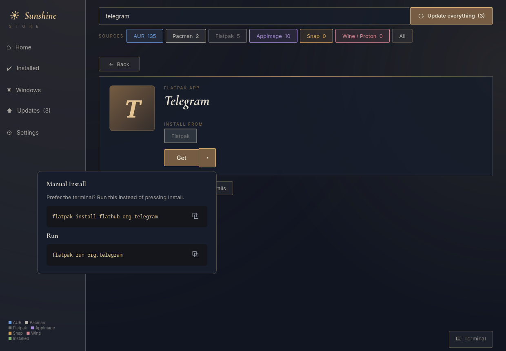
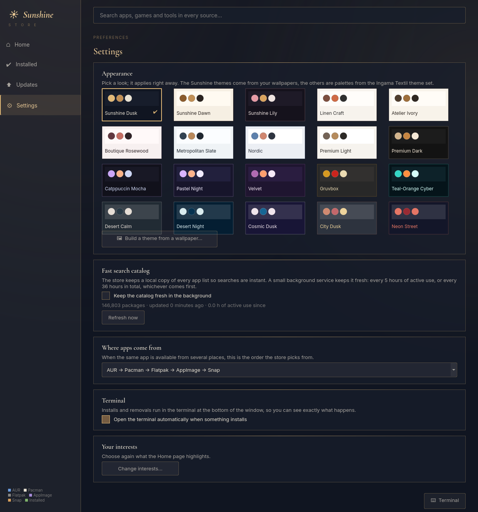

# Sunshine Store

An app store for Arch Linux in the style of the Microsoft Store and GNOME Software. One search covers **pacman**,
the **AUR**, **Flatpak**, **AppImage** and **Snap**, and the same app from several places is shown as one card.
Built for [Sunshine OS](https://github.com/tak0dan); works on any Arch system.

## Highlights
- **Instant search.** A local catalog (every repo package, the whole AUR, Flathub, AppImage and Arch's AppStream data)
  is searched in milliseconds instead of waiting on three slow tools. Open an AUR page and its votes and version are
  refreshed live.
- **Optional background service** keeps the catalog fresh: every **5 hours of active use** or every **36 hours** in
  total, whichever comes first. Turn it on or off in *Settings*; it also refreshes on demand.
- **Five sources, colour-coded frames:** blue = AUR, white = Pacman, gray = Flatpak, violet = AppImage, orange = Snap,
  **green = installed**. You choose the source order (default AUR, Pacman, Flatpak, AppImage, Snap).
- **Interests on first launch** (games, music, design, study, coding...) decide which shelves the Home page shows.
- **The install command is always visible** and copyable, and it changes with the source you pick.
- **Linked terminal.** A terminal at the bottom (toggle with Ctrl+`) runs every install and removal, with full colour
  output and live progress, and answers prompts typed into it. Drag its top edge to resize it; the height is remembered.
- **Theme changer.** 20 themes in *Settings → Appearance*, applied instantly: three calm Sunshine themes from the Sunshine OS
  wallpapers (the default, *Sunshine Dusk*, is navy and soft gold) and 17 palettes from the Ingama Textil theme set.
  *Build a theme from a wallpaper…* makes a palette from any image. Text contrast is checked so every theme stays readable.
- Related versions (`-bin`, `-git`, ...) from the AUR on every product page.

## Install
Arch / AUR: `yay -S sunshine-store`  (the AUR package is updated at each release)
From source: `sudo make install`

Needs `python-pyqt6`, `polkit`; recommended: `libjxl` (repo app icons), `yay` (AUR installs), `flatpak`,
`archlinux-appstream-data`, `inter-font`, `ttf-cormorant`. Snap results appear only when `snapd` is installed.
Enable the background catalog service: `systemctl --user enable --now sunshine-store-indexer.timer` (or use Settings).

## Command line
`sunshine-store-index --refresh | --status` manages the catalog; `sunshine-store-appimage install owner/repo` installs
an AppImage into `~/Applications` with a menu entry.

## License
GPL-3.0-or-later
